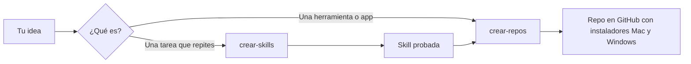

<h1 align="center">Kit Creador Maestría</h1>

<p align="center"><b>Convierte tus ideas en skills de Claude y en proyectos completos en GitHub, listos para instalar en Mac y Windows.</b></p>

<p align="center">
  
  
  
</p>

## Qué hace

- **Convierte una tarea que repites en una skill**: Claude te hace las preguntas justas, escribe la skill y la revisa con un script.
- **Crea tu proyecto en un repo de GitHub**: una app local, un plugin de skills o un motor de scripts. Lo construye desde tu idea o monta el repo sobre lo que ya tienes.
- **Con la estructura de los proyectos Maestría**: README con portada, un CLAUDE.md que hace de manual para Claude, guía de instalación e instaladores para Mac y Windows.
- **No se te escapa nada personal**: revisa claves, rutas de tu ordenador, archivos pesados y las palabras que tú digas, y no publica nada sin tu sí.

## Qué incluye

| Skill | Qué hace | Cómo se activa |
|---|---|---|
| `crear-skills` | Crea, mejora y prueba una skill de principio a fin | "Crea una skill para ..." · "Mi skill no se activa" |
| `crear-repos` | Crea un proyecto completo (app, plugin o motor) y lo publica en GitHub | "Quiero una herramienta que ..." · "Sube mi proyecto a GitHub" |

## Cómo funciona



`crear-repos` te pregunta al empezar si quieres que **construya el proyecto entero** desde tu idea o que **solo monte la estructura** sobre lo que ya tienes.

## Instalación

**Requisitos**
- [Claude Code](https://code.claude.com/docs/en/setup) (Mac o Windows).
- **Windows:** [Git for Windows](https://git-scm.com/downloads/win). Sin él, Claude Code no puede ejecutar los scripts de revisión.
- Para publicar en GitHub (`crear-repos`): [GitHub CLI](https://cli.github.com/) y haber hecho una vez `gh auth login`.

**Dentro de Claude Code**, escribe estos dos comandos, uno detrás de otro:

```
/plugin marketplace add eternitydevzz/kit-creador-maestria
```

```
/plugin install kit-creador-maestria@kit-creador-maestria
```

Después abre una sesión nueva de Claude Code.

## Uso

Escribe en Claude Code, con tus palabras:

> Crea una skill para convertir mis notas de reunión en una lista de tareas

Claude te hará unas preguntas (qué resultado quieres, un ejemplo real, dónde la usarás), escribirá la skill, la revisará y te dirá cómo probarla.

Para crear un proyecto:

> Quiero una herramienta que convierta mis vídeos largos en clips para Instagram, y subirla a GitHub para mi equipo

También puedes llamarlas directamente: `/kit-creador-maestria:crear-skills` y `/kit-creador-maestria:crear-repos`.

**Antes de publicar nada**, Claude te enseña la cuenta, el nombre, si es público o privado y la lista de archivos, y espera tu sí.

## Actualizar

```
/plugin marketplace update kit-creador-maestria
```

## Problemas frecuentes

- **La skill no aparece después de instalar**: abre una sesión nueva de Claude Code.
- **En Windows dice que no encuentra `bash`**: instala Git for Windows y vuelve a abrir Claude Code.
- **`gh: command not found` al publicar**: instala GitHub CLI y haz `gh auth login`.
- **Publica en otra cuenta de GitHub**: mira con `gh auth status` qué cuenta está activa y cámbiala con `gh auth switch`.

## Licencia

MIT. Ver [LICENSE](LICENSE).
